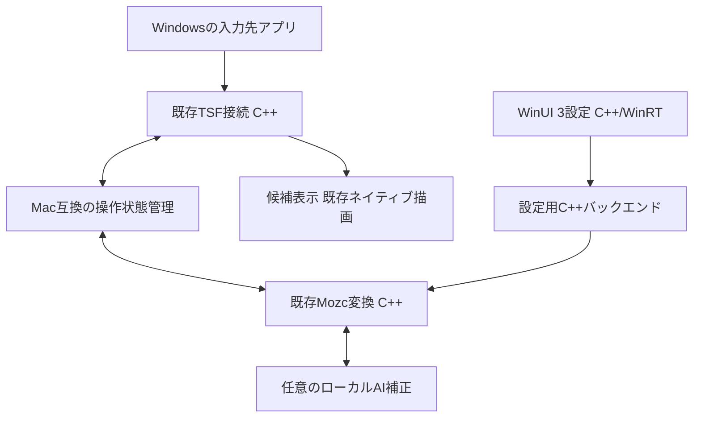

# 実装方針

更新：2026-11-25／方針リビジョン3（Sumiへの移行）  
上流調査：`koyasi777/mozkey@0eaeef17e37a576301cba759e7a1c5419f77c42d`（前回調査時点）  
Sumiの移行時点のFork HEAD：`45ce6a4b0c1387f00f3e04decb31e29d024d54cd`。差分を確認して開発ベースを固定する。

## 1. 目的と優先順位

WindowsでmacOS標準日本語入力と同じ感覚で入力できるIMEを作る。

優先順位は、(1)入力操作の互換性、(2)文字欠落を起こさない安定性、(3)候補とアイコンの外観、(4)省メモリ・低CPU負荷、(5)配布品質とする。WinUI 3設定画面は初版の必須機能であり、最後の装飾工程にはしない。

以前の計画のうち、以下を更新する。

| 以前の案 | 現在の決定 |
| --- | --- |
| 独自に「最初のSpaceは候補を開くだけ」と決める | Mac実機の各状態で記録した挙動に合わせる |
| Escは一覧を閉じる→読みへ戻す等の段階を提案 | Mac実機の順序・対象範囲を確認して再現 |
| Tabを手動予測要求として使う案 | Macの状態別動作を確認。未検証の割当は追加しない |
| Zenz表示からSpaceでMozcへ戻す既存動作を優先 | 互換モードの外部操作はMacを正とし、エンジン内部の都合をキーへ露出させない |
| 初版はQt設定画面を整理 | 初版からWinUI 3。通常の設定・辞書・キー設定をWinUI内で完結 |
| 予測・ルビ・状態表示を一律に隠す独自仕様 | Macにもある設定を合わせて再現。追加の非表示機能は互換確認後の拡張 |
| Rustによる省メモリ化 | 同条件で測定して部分採用を判断。この方針は維持 |

初版では互換性の確認を先に行い、全角英数字禁止、独自の句読点確定、アプリ別自動モード、独自のキーショートカットなどは後続拡張に分ける。

## 2. 対応と基準

- Windows 11 ARM64・x64を対象とする。
- ARM64 Windows実機で入力、消費メモリ、CPU、復帰時の動作を確認する。
- Mac側は参照機を決め、macOS版・ビルド、日本語入力設定、JIS/US配列、学習状態を記録する。
- 公開資料にあるmacOS 26/27を、参照機のバージョンと決めつけない。
- macOSの辞書とMozcの辞書の違いは、操作不一致と別に記録する。

上流には正式配布版と、その後のmainの変更がある。試用した配布版、正式配布版、開発ベースを区別する。開発開始時に安定性を確認してベースを固定し、性能比較は同じコミットの未改変版と改変版で行う。

## 3. 構成

責務を示す概念図。現実の候補描画には外部プロセスとアプリ内の経路があり、AIにもscorerとllama-serverの複数プロセスがある。初期測定でbroker、cache service等を含む実プロセス一覧を作る。

### 入力エンジンとWindows接続

既存のC++変換エンジン、TSF接続、x86/x64/ARM64およびARM64X forwarderを活かす。各アプリに読み込まれるTSF DLLへ設定UIやAIモデルを組み込まない。

Mac互換操作は、キー入力→状態遷移→表示・確定の責務を整理して実装する。既存のMac風キーマップを設定しただけで完全互換とはみなさず、状態ごとの確定・取消・文節範囲を検証する。

### 候補UI

Windows候補描画は既存Win32・DirectWrite/Direct2Dを活用する。通常アプリの外部レンダラーと、Windows Search等のアプリ内レンダラーを共に検証する。

Macの候補レイアウト、表示条件、選択色、文字密度、余白、位置、開閉タイミングを実測する。DPI、Windowsの文字描画、アクセシビリティによる差は記録し、見た目を評価せずに「完全一致」とはしない。ブランド・モードアイコンは小さい表示専用の素材を用意する。

### 設定UI

WinUI 3＋C++/WinRTの別プロセスを初版から作る。通常入力時は起動せず、閉じたら終了する。詳細は[WinUI 3設定仕様](winui3-settings.md)。

## 4. 予測表示・AIとMac互換性

ライブ変換、自動予測、手動変換、AI補正は別機能として管理する。互換モードは、基準Macの「ライブ変換ON・推測候補表示OFF」に合わせる。

現行Mozkeyでは、ライブ変換の自動予測に別のImeContextや候補キャッシュを使う。画面だけ隠すとキー解釈と内部候補が一致しなくなる可能性があるため、次を一緒に変更する。

- 通常COMPOSITION、ライブ変換待機中、ライブ変換表示中の自動予測生成・出力。
- 古い候補キャッシュ、表示中とみなす状態、候補IDとの対応。
- 候補を明示的に開いた際の選択・確定・取消。
- 非同期AI結果の世代、入力セッション、フォーカスとの対応。

AI ON/OFFで同じキーの外部的な意味を変えない。候補選択を開始した後にAIがユーザーの選択を上書きしない。Macと差のあるZenz固有の表示・キー操作・句読点確定は、互換プロファイルでは調整または無効化する。

自動予測を出さないことと、ライブ変換自体を止めることを混同しない。`use_realtime_conversion`はサジェストへ通常変換候補を含める設定であり、`use_live_conversion`とは別である。

## 5. 主な変更箇所

| 目的 | 上流の主なパス |
| --- | --- |
| 設定・互換プロファイル | `src/protocol/config.proto` |
| 初期値・設定移行・永続化 | `src/config/config_handler.cc` |
| キー、文節、候補、確定・取消 | `src/session/session.cc`、キー設定関連 |
| 候補の表示・配置 | `src/renderer/win32/window_manager.cc`、`candidate_window.cc` |
| 文字・共通スタイル | `src/renderer/win32/text_renderer.cc`、`src/renderer/renderer_style_handler.cc` |
| WinUIへの機能移植元 | `src/gui/config_dialog/`、`src/gui/dictionary_tool/`、キー・ローマ字テーブル編集関連 |
| 設定接続 | `src/client/client_interface.h`、`client.cc` |
| アイコン | `src/data/images/`、`src/win32/tip/tip_resource.rc` |
| AIの寿命 | `src/zenz_scorer/main.cc`、`src/session/zenz_named_pipe_client.cc` |
| 識別子・配布 | `src/base/const.h`、`src/win32/base/tsf_profile.cc`、`src/win32/installer/` |

新しいWinUIプロジェクトのパスやビルド統合方法は、未改変Windowsビルドと小さな接続試作を通して固定する。既存のBazelコードとWinUI側のMSBuildの境界を小さく保つ。

## 6. 元Mozkeyとの共存

新製品の初版で、TSF COMクラスGUID、入力プロファイルGUID、MSI UpgradeCode、インストール先、設定・学習・辞書保存先、パイプ・mutex・event、スタートアップやサービス等の識別子を分離する。

ユーザー辞書と設定は明示的なインポートで移す。元Mozkeyを更新・削除しても新IMEが動き、新IMEを更新・削除しても元Mozkeyが動くことを確認する。

Sumiを開発名として使用する。正式なブランド・商標・製品識別子は配布前に確認し、上流のブランドやリソース識別子と区別する。

## 7. Storeとライセンス

Sumiの方針は、上流のBSD系ライセンス・第三者の権利を維持したうえで、権利を有する独自実装を可能な限り非公開にすること。公開Forkには秘密の実装をpushしない。独立したPrivateリポジトリへソースと履歴を複製して開発する構成を採用候補とし、作成後にremote・公開範囲を確認する。[ライセンス・非公開開発方針](licensing.md)を必須の配布条件とする。

WinUI 3移行では出荷物からQt依存を除去することを目標にする。残るQt利用があればLGPL等の条件・Storeとの適合を確認する。辞書は出荷データの出典・ライセンス単位で監査し、権利が不明なデータは除外または許諾取得する。機能や精度に影響する場合は比較試験し、差を報告する。

MSI/EXEでのStore掲載を候補にする。WinUI 3設定アプリはunpackaged構成で同梱できるため、その採用だけを理由にIME全体をMSIXへ移行しない。

最初に確認する事項：

1. 現行MSIが登録する自動起動Windowsサービス`MozcCacheService`の必要性。
2. サービスなしの起動・入力・ユーザー切替・更新が成立するか。
3. Storeポリシー10.2.4との適合。サービス依存を隠さず扱う。
4. 全PEファイルとインストーラーの署名、固定HTTPS URL、サイレント・オフライン導入。
5. WinUI 3/Windows App SDK/CRTを含むclean環境での依存解決。
6. 辞書、モデル、ランタイム、残る第三者部品の再配布条件。
7. 更新・削除・既存IMEとの共存。

本体のBSD系条件だけで、追加辞書等を含む完成パッケージの条件は決まらない。出荷版の通知と原文を確認する。Store審査通過は未確認であり、設計資料で保証しない。

## 8. 検証と完了の定義

Mac操作の受入条件は[互換仕様](macos-input-compatibility.md)、設定画面は[WinUI仕様](winui3-settings.md)、性能は[測定計画](performance-and-rust.md)を正とする。

Windows実機ではメモ帳、Edge、Office、Zed、Windows Search、昇格アプリを対象に、実行アーキテクチャを確認して試験する。フォーカス、複数DPI、タッチキーボード、縦書き、スリープ復帰、Win+Space、再変換、読み上げを含める。

入力欠落や確定範囲の不一致を残したまま、候補が似ていることだけで完了しない。Mac実機確認前の項目は未検証として残す。

## 9. 開発環境と記録

Mac側には編集・参照・実機挙動記録を担当させ、Windowsのビルドと試験は利用可能なWindows環境またはCIで行う。Macに大きなWindows開発環境を追加する前提にはしない。CIの利用条件・費用は採用時に確認する。

変更は入力互換、WinUI設定、外観、性能、配布の単位でGitに記録する。実装開始時に期間を見積もり、署名・Store審査の待ち時間は分ける。現時点で削減MB数や互換性達成を約束しない。

## 10. 非公開開発の境界

- 公開Forkにはこの設計資料、上流由来のコードおよび公開を明示的に承認した変更だけを置く。
- 独自のWinUI 3設定、操作互換、描画、性能改善などの実装・試験成果物は、原則として独立Privateリポジトリで管理する。既存OSS部分は私有化・再許諾せず元の権利を保つ。
- 上流の取込みをPrivate側で行い、公開側へ履歴・パッチ・ビルドログ・未公開資産が漏れないようにする。変更を公開する際は差分とライセンス範囲を確認する。
- 非公開リポジトリ作成は未実施。公開Forkに秘密のコードをpushしてから消す方法は用いない。
